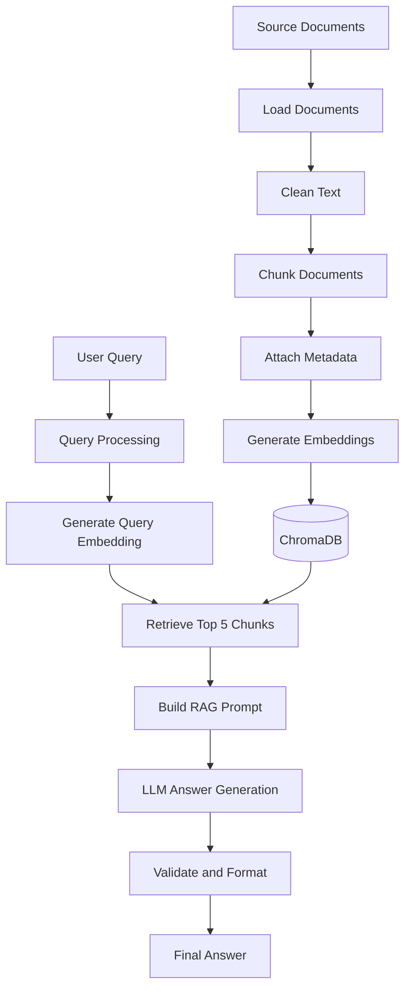

# RAG Project — From Scratch

A lightweight **Retrieval-Augmented Generation (RAG)** system built from scratch using Python, ChromaDB, and an OpenAI-compatible API, without relying on high-level RAG frameworks such as LangChain or LlamaIndex.

The project demonstrates the core stages of a RAG pipeline: document ingestion, text preprocessing, chunking, embedding generation, vector storage, semantic retrieval, prompt construction, and LLM-based answer generation.

## Overview

Traditional LLM applications rely primarily on the knowledge acquired during model training. RAG enhances this approach by retrieving relevant information from an external knowledge source before generating an answer.

This project implements a complete, modular RAG pipeline using an internal company policy document as its knowledge base.

The system retrieves relevant sections of the document and provides them as context to an LLM, which generates an answer in Persian based on the retrieved information.

### Key Features

- **Custom RAG Pipeline:** Implements the core RAG workflow without high-level RAG frameworks.
- **Document Ingestion:** Loads text documents from a local knowledge source.
- **Text Preprocessing:** Normalizes whitespace and line breaks before indexing.
- **Text Chunking:** Splits documents into manageable chunks for retrieval.
- **Embedding Generation:** Converts text and user queries into vector representations.
- **Vector Database:** Uses ChromaDB for persistent storage and similarity-based retrieval.
- **Semantic Search:** Retrieves the most relevant document chunks for a given query.
- **Context-Aware Generation:** Constructs prompts using retrieved information.
- **Grounded Responses:** Instructs the LLM to answer using the provided context and report when the information is unavailable.
- **Modular Architecture:** Separates document processing, retrieval, query handling, generation, and configuration.

## Architecture

The pipeline consists of two main phases: document ingestion and query processing.



### 1. Document Ingestion

The ingestion phase prepares the knowledge base for retrieval.

1. Load the source document from `data/rules.txt`.
2. Normalize line breaks and whitespace.
3. Split the document into chunks of up to 800 characters.
4. Attach metadata, including chunk IDs and source information.
5. Generate embeddings for each chunk.
6. Store the document chunks, embeddings, and metadata in ChromaDB.

The application checks whether the vector collection already contains indexed records. If the collection is empty, it runs the ingestion pipeline.

### 2. Query Processing

When a user submits a question, the application follows these steps:

1. Receive the user's query through the command-line interface.
2. Normalize the query using the current query-processing function.
3. Generate an embedding for the query.
4. Retrieve the five most relevant chunks from ChromaDB.
5. Construct a prompt containing the retrieved context and the original question.
6. Send the prompt to the configured language model.
7. Validate and format the generated response.

The prompt instructs the language model to answer in Persian, use only the retrieved context, and indicate when the requested information cannot be found.

## Technology Stack

| Technology | Purpose |
|---|---|
| Python | Core application logic |
| ChromaDB | Persistent vector storage and similarity search |
| OpenAI Python SDK | API communication for embeddings and chat completions |
| OpenAI-compatible API | Embedding generation and LLM inference |
| python-dotenv | Loading configuration from environment variables |

**Note:** The project uses an OpenAI-compatible API endpoint configured in the source code. The actual embedding and chat models are selected through environment variables.

## Project Structure

```text
RAG_Project/
│
├── main.py
├── config.py
│
├── data/
│   └── rules.txt
│
├── db/
│   └── vectors.db/
│       └── ChromaDB persistent storage
│
└── steps/
    ├── __init__.py
    ├── document.py
    ├── retrieval.py
    ├── query.py
    ├── generation.py
    └── logger.py
```

### Module Responsibilities

| File | Responsibility |
|---|---|
| `main.py` | Orchestrates the complete RAG pipeline |
| `config.py` | Defines API configuration, model names, chunk size, and vector database settings |
| `steps/document.py` | Loads, cleans, chunks, and indexes documents |
| `steps/retrieval.py` | Generates embeddings and retrieves relevant document chunks |
| `steps/query.py` | Handles user input and query preprocessing |
| `steps/generation.py` | Builds the RAG prompt and generates the final answer |
| `steps/logger.py` | Provides lightweight logging functionality |
| `data/rules.txt` | Contains the source knowledge used by the application |
| `db/vectors.db/` | Stores the persistent ChromaDB collection |

## Getting Started

### Prerequisites

- Python 3.10 or later
- An API key for the configured API provider
- Access to compatible embedding and chat models

The project requires Python packages for vector storage, API communication, and environment-variable management.

### 1. Clone the Repository

```bash
git clone https://github.com/behrouzyou/RAG_Project.git
cd RAG_Project
```

### 2. Create a Virtual Environment

**Windows:**

```bash
python -m venv .venv
.venv\Scripts\activate
```

**Linux / macOS:**

```bash
python3 -m venv .venv
source .venv/bin/activate
```

### 3. Install Dependencies

Install the required packages:

```bash
pip install chromadb openai python-dotenv
```

### 4. Configure Environment Variables

Create a `.env` file in the project root:

```env
OPENAI_API_KEY=your_api_key
OPENAI_CHAT_MODEL=your_chat_model
OPENAI_EMBEDDING_MODEL=your_embedding_model
```

Replace the placeholder values with valid credentials and model identifiers supported by your configured API provider.

**Important:** The API endpoint is currently configured in the Python source code. The application uses `https://api.gapgpt.app/v1` for API requests, so the credentials and model names must be compatible with that provider.

Never commit your actual API key to a public repository.

### 5. Run the Application

```bash
python main.py
```

Enter your question when prompted:

```text
Query:
```

The application retrieves relevant information from the indexed knowledge base and generates a response.

## Example Usage

The current knowledge base contains internal company policies covering working hours, remote work, leave requests, equipment usage, customer confidentiality, and other workplace procedures.

**Example query:**

```text
شرایط دورکاری کارکنان چیست؟
```

The system retrieves relevant sections from the company policy document and passes them to the language model.

The expected response should describe the remote-work policy using the retrieved information.

If the answer is not available in the retrieved context, the prompt instructs the model to respond:

```text
در فایل قوانین چیزی درباره این مورد پیدا نکردم.
```

*The example illustrates the intended behavior; the actual response depends on retrieval results and model output.*

## Configuration

The primary settings are defined in `config.py`.

| Parameter | Description |
|---|---|
| `API_KEY` | API credential loaded from the environment |
| `CHAT_MODEL` | Language model used for answer generation |
| `EMBEDDING_MODEL` | Model used to generate text embeddings |
| `RULES_FILE` | Path to the source knowledge document |
| `CHUNK_SIZE` | Maximum character count per chunk, currently 800 |
| `VECTOR_DB_PATH` | Path to persistent ChromaDB storage |
| `VECTOR_COLLECTION_NAME` | Name of the vector collection, currently `rules` |

## Design Principles

### No High-Level RAG Frameworks

The application implements the major RAG stages explicitly rather than delegating the entire workflow to a high-level RAG framework.

This makes the internal pipeline easier to inspect and provides a practical way to understand how retrieval and generation interact.

### Modular Design

Each major responsibility is separated into its own module.

This separation makes the project easier to maintain and provides a foundation for extending individual stages without rewriting the entire pipeline.

### Persistent Vector Storage

ChromaDB stores document embeddings and associated metadata on disk, allowing the application to reuse an existing index across executions.

### Context-Grounded Generation

The prompt explicitly restricts the language model to the retrieved context and specifies a fallback response for questions that cannot be answered from that context.

This design encourages grounded answers, although prompt instructions alone cannot guarantee that a language model will never produce unsupported information.

## Current Scope and Limitations

The current implementation is intentionally lightweight and focuses on the fundamental mechanics of RAG.

- **Input format:** Document ingestion currently reads a single text file.
- **Chunking strategy:** Documents are divided into fixed-size character chunks without overlapping windows.
- **Query processing:** The current query-processing function strips surrounding whitespace; it does not yet implement LLM-based query rewriting.
- **Retrieval:** The application retrieves up to five chunks per query.
- **Evaluation:** Automated retrieval evaluation, answer-quality metrics, and systematic hallucination testing are not currently implemented in the pipeline.
- **Interface:** The application currently uses a command-line interface.
- **Index management:** The ingestion check only tests whether the collection is empty. Changes to the source document are not automatically detected and reindexed.

These are areas where the system could be extended as the project evolves.

## Future Improvements

Potential directions for further development include:

- Support for PDF, DOCX, and other document formats.
- Recursive or semantic chunking strategies.
- Overlapping chunks to preserve context across boundaries.
- Query rewriting and query expansion.
- Hybrid retrieval combining vector search with keyword-based search.
- Reranking retrieved chunks to improve relevance.
- Configurable retrieval parameters and similarity thresholds.
- Source citations and more explicit evidence attribution.
- Automated evaluation of retrieval quality and generated answers.
- A web-based interface using Streamlit or Gradio.
- API integration for use by other applications.

## Learning Objectives

This project explores the fundamental building blocks of a RAG system:

- Document ingestion and preprocessing
- Text chunking and metadata management
- Embedding generation
- Vector databases and semantic retrieval
- Context construction and prompt engineering
- LLM-based answer generation
- Modular Python application design

The primary goal is to understand and implement the RAG workflow at the component level rather than relying on an abstraction that hides its internal stages.

## Author

**Behrouz**

GitHub: [@behrouzyou](https://github.com/behrouzyou)

---

*Built as a practical project to explore Retrieval-Augmented Generation and understand its underlying components through a custom Python implementation.*
